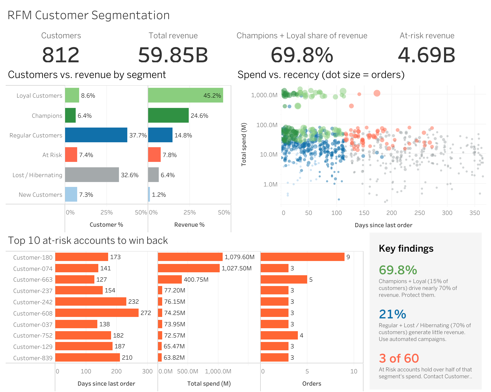

# 📊 Customer Segmentation using RFM Analysis (SQL & Tableau)

> **A SQL and Tableau project demonstrating data extraction, transformation, and customer behavior analysis using the RFM (Recency, Frequency, Monetary) model, with a dashboard that turns the segments into business actions.**


-20BEFF?logo=kaggle&logoColor=white)


---

## 📑 Table of Contents

- [Project Objective](#-project-objective)
- [Background](#-background)
- [Data Source](#-data-source)
- [Technical Skills Demonstrated](#-technical-skills-demonstrated)
- [Project Structure & Workflow](#-project-structure--workflow)
- [Dashboard (Tableau)](#-dashboard-tableau)
- [Key Business Insights](#-key-business-insights)
- [Applying This to Financial Services](#-applying-this-to-financial-services)
- [Limitations & Future Improvements](#-limitations--future-improvements)
- [How to Run the Code](#-how-to-run-the-code)

---

## 🎯 Project Objective

To segment customers based on their purchasing behavior. This allows the marketing and sales teams to tailor targeted campaigns, optimize retention strategies, and maximize overall revenue.

---

## 💡 Background

With a minor in Marketing, I've built brand marketing plans and STP (Segmentation, Targeting, Positioning) analyses as academic coursework. This project applies the same segmentation idea to a raw retail transaction dataset, using SQL to clean the data and build behavioral segments through RFM analysis, then Tableau to present the results as a one-page dashboard.

---

## 📊 Data Source

The dataset used in this project is publicly available on Kaggle. It contains transactional records including customer IDs, purchase dates, product categories, regions, and transaction amounts.

| Item | Details |
|---|---|
| **Source** | [raw_rfm_sales_transactions_(V2).csv](https://www.kaggle.com/datasets/charmmyaeaung/raw-sales-dataset-for-rfm-customer-segmentation?select=raw_rfm_sales_transactions_%28V2%29.csv) |
| **Size** | 2,000 transactions from 812 customers, covering Jan–Dec 2025 |

---

## 🔧 Technical Skills Demonstrated

| Area | Details |
|---|---|
| **Database Management** | Schema Design, Raw-to-Clean Staging Layer, Indexing, Views |
| **Data Wrangling** | Type Casting, String Manipulation, Date Standardization, Data Validation |
| **SQL** | Window Functions (`CUME_DIST`, `SUM() OVER`), Common Table Expressions (CTEs), Subqueries |
| **Business Intelligence** | Data Aggregation, Customer Cohort Segmentation |
| **Data Visualization** | Tableau dashboard design: KPI cards, segment bar charts, log-scale scatter plot, ranked win-back list |

---

## 📂 Project Structure & Workflow

```
01_schema_and_setup.sql               →  Data cleaning & preprocessing
02_rfm_analysis_and_insights.sql      →  RFM modeling & insights
RFM_Customer_Segmentation.twbx        →  Tableau dashboard
RFM_Customer_Segmentation.png         →  Dashboard preview image
```

### 📄 `01_schema_and_setup.sql` (Data Cleaning & Preprocessing)

| Step | What was done |
|---|---|
| **Staging layer** | Kept `Customer_DB` as the raw layer (loaded as-is from CSV) and built a separate `Customer_Clean` staging table, so raw data is never modified. |
| **Type conversion** | Converted string columns to proper types (`Quantity` → `INT`, `PPU`/`Amount` → `DECIMAL(12,2)`) and standardized `DD-MM-YYYY` strings into native `DATE`. |
| **Validation** | Row counts match the raw table (2,000), no invalid quantities or amounts, and `Amount = Quantity × PPU` on every row. |
| **Indexing** | Created a covering index on `(customer_id, order_date, amount)` to support the RFM aggregation query (verified with `EXPLAIN`: `Using index`). |

### 📄 `02_rfm_analysis_and_insights.sql` (RFM Modeling & Insights)

Calculated RFM metrics using **CTEs** inside a view (`vw_customer_segmentation`) and assigned scores from 1 to 5:

| Metric | Definition | Scoring method |
|---|---|---|
| **Recency (R)** | Days since the last purchase | `CUME_DIST()`, reversed scoring (5 is best) |
| **Frequency (F)** | Number of distinct transactions | **Fixed thresholds** (1, 2, 3, 4, 5+ purchases) instead of percentiles, because many customers bought only once |
| **Monetary (M)** | Total amount spent | `CUME_DIST()` (5 is the highest spend) |

Customers were categorized into strategic groups based on their RFM scores:

| Segment | Description | Actionable Strategy |
| :--- | :--- | :--- |
| 🏆 **Champions** | Bought very recently, buy often, and spend a lot (R = 5, F ≥ 4, M ≥ 4). | Reward them, offer early access to new products. |
| 🤝 **Loyal Customers** | Bought fairly recently, purchase regularly, and spend good money (R = 3–4, F ≥ 4, M ≥ 4). | Upsell higher-value products, ask for reviews. |
| 👋 **New Customers** | Bought recently but only once so far (R ≥ 4, F = 1). | Provide onboarding support, offer 2nd-purchase discounts. |
| ⚠️ **At Risk** | Purchased several times with decent spend but haven't returned lately (R ≤ 2, F ≥ 3, M ≥ 3). | Send personalized "We miss you" win-back offers. |
| 💤 **Lost / Hibernating** | Haven't purchased recently and bought rarely (R ≤ 2, F ≤ 2). | Do not spend high marketing budget here. |
| 📦 **Regular Customers** | All remaining customers not matched above (e.g., mid-recency R = 3, repeat buyers with F = 2–3 and R ≥ 4, or frequent buyers with lower spend). | Nurture with standard promotions to move them up. |

---

## 📈 Dashboard (Tableau)

A one-page Tableau dashboard built from the segmentation output (`rfm_segments.csv`, exported from the `vw_customer_segmentation` view). It turns the SQL results into something a sales or marketing team can scan in a minute: how big each segment is, how much revenue it brings, and which at-risk accounts to call first.



🔗 **Live version:** [View on Tableau Public](https://public.tableau.com/views/RFMCustomerSegmentation_17952664681280/RFMCustomerSegmentation)

| Panel | What it shows |
|---|---|
| **KPI cards** | 812 customers, 59.85B total revenue, 69.8% of revenue from Champions + Loyal, and 4.69B of revenue sitting in the At Risk segment |
| **Customers vs. revenue by segment** | Each segment's share of customers next to its share of revenue, to show how concentrated the value is |
| **Spend vs. recency** | One dot per customer: x = days since last order, y = total spend (log scale), dot size = number of orders, color = segment |
| **Top 10 at-risk accounts to win back** | At Risk customers ranked by total spend, with days since last order and order count, as a call list for sales |
| **Key findings** | Three plain-language takeaways for the business |

Segment share of customers vs. revenue (as shown in the dashboard):

| Segment | % of customers | % of revenue |
|---|---|---|
| Loyal Customers | 8.6% | 45.2% |
| Champions | 6.4% | 24.6% |
| Regular Customers | 37.7% | 14.8% |
| At Risk | 7.4% | 7.8% |
| Lost / Hibernating | 32.6% | 6.4% |
| New Customers | 7.3% | 1.2% |

Reading notes:

- **Units:** M = million and B = billion, in the dataset's currency units (the currency is not specified).
- **Log scale:** the spend axis in the scatter plot is logarithmic so that accounts above 1,000M and accounts below 10M are visible together. Vertical distances are not proportional to differences in spend.
- **Colors:** segment colors are the same in the bar chart and the scatter plot.
- **Coverage:** the dashboard covers the headline concentration finding and insight 1 (who to contact first). Insights 2-5 (product mix, regions, order value, first-purchase timing) are in the SQL output only.

---

## 💡 Key Business Insights

> [!IMPORTANT]
> **Champions and Loyal customers make up just 15.0% of customers (122) but generate 69.8% of revenue.**
>
> At the other end, Regular and Lost / Hibernating customers make up ~70% of customers but only ~21% of revenue.

Segmentation then answers five business questions:

| # | Question | Finding | Recommended Action |
|---|----------|---------|--------------------|
| 1 | Who should sales contact first? | 60 customers are "At Risk" (7.4% of customers, 4.69B or 7.8% of revenue), and the top 3 accounts make up ~54% of the segment's revenue | Personal outreach to Customer-180, Customer-074, Customer-663 (see the win-back list in the [dashboard](#-dashboard-tableau)) |
| 2 | What do Champions buy? | Electronics drives 68.2% of Champions' revenue, while Office Supplies is 20.1% of their orders but only 2.1% of revenue | Bundle Office Supplies as an add-on |
| 3 | Where are we losing customers? | "Lost" share is highest in Taunggyi (40.3%), Naypyitaw (39.7%), Bago (37.4%) vs. Yangon (25.5%), Mandalay (26.8%) | Investigate operations in the high-churn regions |
| 4 | Do Champions spend more per order? | AOV is ~4.1x that of Regular customers (51.1M vs 12.4M) | Test bundles and upsells to raise order value among Regular customers. Reward Champions with perks (e.g., early access) rather than blanket discounts, since they already buy large orders. |
| 5 | When do new customers arrive? | 20.6% of customers first purchased in January, and 57.8% had by the end of April | Read with caution (see [Limitations](#-limitations--future-improvements)) |

*Amounts are in the dataset's currency units; the currency is not specified.*

---

## 🏦 Applying This to Financial Services

This project uses retail data. The same framework could be adapted to a financial services setting (e.g., credit cards, loans, installment programs). This is a proposed adaptation and is not implemented in this project.

| Metric | In this project (retail) | Possible version in financial services |
|---|---|---|
| **Recency** | Days since the last purchase | Days since the last card transaction or loan payment |
| **Frequency** | Number of distinct transactions | Number of transactions per month, or number of active months |
| **Monetary** | Total amount spent | Card spend, or revenue from the customer (e.g., interest and fees) |

What would need to change:

- **RFM describes engagement and value, not credit risk.** Delinquency, repayment history, and credit limit utilization would need to be analyzed separately, and risk should be reviewed before any campaign targets a segment.
- **Segment actions change with the product.** For example, an "At Risk" card holder might receive a reactivation offer, while a high-value customer with rising utilization may need a different treatment.
- **Customer data privacy.** Using personal data for marketing requires attention to consent and data protection rules (e.g., Thailand's PDPA).

---

## 🚧 Limitations & Future Improvements

### Data

- **Small, single-year practice dataset:** 2,000 transactions from 812 customers (Jan–Dec 2025), published for learning. Results demonstrate the method rather than serve as business conclusions, and seasonality can't be separated from trend.
- **Revenue, not profit:** The data has no cost or margin, so segment value is based on sales amount only.
- **Skewed order values:** Median order is 7.75M vs. a max of 600M, so a few large accounts drive revenue shares and the win-back ranking. Rank-based scoring (`CUME_DIST`) limits their effect on segment assignment.
- **Recency is relative to the dataset:** It is measured from the latest transaction date in the data, not today's date.

### Method

- **Tied values affect scoring:** R and M use `CUME_DIST()`, so customers with identical values share the same score and groups are not exactly 20% each. Frequency uses fixed thresholds for the same reason (292 of 812 customers bought once, 207 bought twice), which makes F = 1 and F = 2 very large groups.
- **Rule-based segments, not validated:** The rules are heuristic and haven't been tested against real outcomes. A natural next step is an A/B test of the win-back campaign on "At Risk" customers.
- **Some segments ignore Monetary:** "New Customers" and "Lost / Hibernating" use only R and F, so a high-spending customer can still fall into one of them.
- **"Regular Customers" is a large catch-all:** At about 38% of customers, it mixes mid-recency customers (R = 3) and recent repeat buyers (F = 2–3).

### Interpretation

- **"Lost" is a proxy for churn:** Low recency and frequency suggest, but do not confirm, that a customer has churned. Regional patterns (insight 3) are hypotheses to investigate, not proven causes.
- **Regional shares can swing with small groups:** Insight 3 reports percentages of each region's customers, so a region with few customers can show a large share from just a handful of people. Read the percentages together with the customer counts.
- **First-purchase trend (insight 5):** January may look inflated because customers who bought before 2025 are counted as first-time buyers. With a finite customer base, new buyers also decline naturally over time, so monthly differences are not proof of seasonality.

### Dashboard

- **Win-back list ranks by total spend only:** The top 3 accounts are above 400M, while the other seven are each below 80M, so the list is dominated by a few large accounts. Ranking by recency or by RFM score would give a different call list.
- **Partial coverage:** The dashboard shows insight 1 and the revenue concentration, not insights 2-5.
- **Log-scale spend axis:** Good for seeing small and large accounts together, but it compresses the visual gap between very large and mid-sized accounts.

### Future improvements

- Extend the Tableau dashboard with region and product-category views (insights 2 and 3) and filters.
- Split "Regular Customers" into finer segments (e.g., Potential Loyalists, Need Attention).
- Estimate customer lifetime value using profit data.

---

## 🚀 How to Run the Code

1. **Clone** this repository to your local machine. Requires **MySQL 8.0+** (CTEs and window functions).
2. **One-time setup:** open `01_schema_and_setup.sql` and run section 0 (`CREATE DATABASE` and `CREATE TABLE Customer_DB`) first.
3. **Import the data:** import `raw_rfm_sales_transactions_(V2).csv` into `Customer_DB` and confirm 2,000 rows.
4. **Build the clean table:** run the rest of `01_schema_and_setup.sql` to build `Customer_Clean`, validate it, and create the index. The raw table is never modified.
5. **Run the analysis:** run `02_rfm_analysis_and_insights.sql` to build the RFM view and view business insights.
6. **View the dashboard:** open `RFM_Customer_Segmentation.twbx` in Tableau Public or Tableau Desktop, or use the [live version] To rebuild it, export the `vw_customer_segmentation` view to `rfm_segments.csv` and connect Tableau to that file.(https://public.tableau.com/views/RFMCustomerSegmentation_17952664681280/RFMCustomerSegmentation). To rebuild it, connect Tableau to the `vw_customer_segmentation` view in MySQL (or export the view to CSV and connect to the file).
---
*Created by Poomrat Thanapasee | Connect with me on [LinkedIn](https://www.linkedin.com/in/poomrat-thanapasee-6a99443b3/)*
